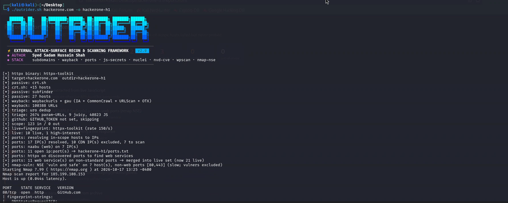
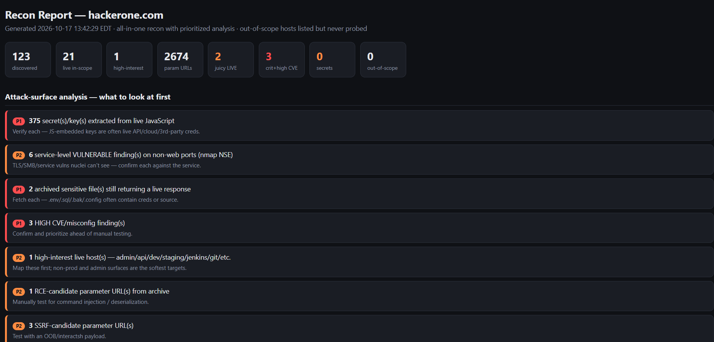

<h1 align="center">OUTRIDER</h1>
<p align="center"><b>External attack-surface recon &amp; scanning framework</b></p>
<p align="center">by <b>Syed Sadam Hussain Shah</b></p>

<p align="center">
  
  
  
  
</p>

---

## Preview

<p align="center">
  
</p>

---

## What it is

**Outrider** maps and scans the external, unauthenticated attack surface of a target in one
pass and produces a single prioritized HTML report — the kind of recon a tester would
otherwise stitch together from a dozen separate tools. It is built for authorized penetration
testing and bug-bounty recon, with scope-safety and WAF/CDN awareness baked in.

## Capabilities

- **Passive discovery** — certificate transparency + subdomain enumeration
- **Wayback intelligence** — archived-URL mining with throttle-resilient collection, then
  triage into injection-candidate parameters (SQLi / SSRF / LFI / RCE / redirect / SSTI),
  juicy files, and JavaScript
- **JavaScript analysis** — endpoint/path extraction and entropy-scored secret detection
  (AWS / Google / GitHub / Stripe / Slack / JWT / private keys), library noise filtered out
- **Port discovery** — CDN-aware port scanning that folds non-standard web services back into
  the pipeline, with an nmap evasion fallback when a firewall filters the scan
- **Block-aware CVE scanning** — tech-aware nuclei with a live WAF/rate-limit oracle that
  batches, backs off, and stops gracefully instead of burning the source IP
- **Version → CVE mapping** — detected software versions matched to known NVD CVEs
- **Service-level checks** — nmap NSE vuln scripts on non-web ports (TLS / SMB / services)
- **WordPress** — auto-detect and enumerate users / plugins / vulnerabilities
- **Prioritized report** — P1/P2/P3 call-outs with recommended next steps, per-host tech↔CVE
  correlation, and copy-paste PoC commands

## Report

<p align="center">
  
</p>

## Who it's for

Penetration testers and bug-bounty hunters who want a fast, safe, one-command external recon
pass that hands the manual-testing phase a complete, prioritized map.

---

## Installation

```bash
git clone https://github.com/Pwned007/outrider.git
cd outrider
chmod +x outrider.sh
```

Requires **Bash** on Linux / WSL / Kali.

### Dependencies

| Tool | Required | Install |
|---|---|---|
| `curl` | Yes | `apt install curl` |
| `jq` | Yes | `apt install jq` |
| `subfinder` | Recommended | `go install github.com/projectdiscovery/subfinder/v2/cmd/subfinder@latest` |
| `httpx` (PD) | Recommended | `apt install httpx-toolkit` (Kali) or `go install github.com/projectdiscovery/httpx/cmd/httpx@latest` |
| `nuclei` | Recommended | `go install github.com/projectdiscovery/nuclei/v3/cmd/nuclei@latest` |
| `naabu` | Recommended | `go install github.com/projectdiscovery/naabu/v2/cmd/naabu@latest` |
| `dnsx` | Recommended | `go install github.com/projectdiscovery/dnsx/cmd/dnsx@latest` |
| `cdncheck` | Recommended | `go install github.com/projectdiscovery/cdncheck/cmd/cdncheck@latest` |
| `nmap` | Recommended | `apt install nmap` |
| `waybackurls` | Recommended | `go install github.com/tomnomnom/waybackurls@latest` |
| `gau` | Recommended | `go install github.com/lc/gau/v2/cmd/gau@latest` |
| `uro` | Recommended | `pip install uro` |
| `trufflehog` | Optional | `go install github.com/trufflesecurity/trufflehog/v3@latest` |
| `wpscan` | Optional | `gem install wpscan` |

Missing tools are warned about at startup and those phases degrade gracefully — only `curl` and `jq` are hard requirements.

### Environment variables (optional)

| Variable | Purpose |
|---|---|
| `GITHUB_TOKEN` | Enable trufflehog GitHub org scanning |
| `NVD_API_KEY` | Faster NVD rate limit (~50 req/30s vs 5) |
| `WPSCAN_API_TOKEN` | Enable wpscan vulnerability database |
| `DNSDUMPSTER_API_KEY` | Extra subdomain source via DNSDumpster API |

---

## Usage

```bash
# Full run against a target (default: in-scope = *.target.com)
./outrider.sh example.com

# Specify output directory and scope file
./outrider.sh example.com -o ./results --scope scope.txt

# Skip GitHub secret scan (no GITHUB_TOKEN set)
./outrider.sh example.com --no-github

# Port discovery: scan only the curated web port list (default)
./outrider.sh example.com --ports web

# Custom port list or top-N
./outrider.sh example.com --ports 80,443,8080,8443,9200
./outrider.sh example.com --ports top1000

# Firewall evasion fallback (nmap source-port 53, fragmented) if no ports found
./outrider.sh example.com --evasion

# Stealth mode: very low nuclei rate + longer back-offs
./outrider.sh example.com --stealth

# Broader nuclei template set (slower, more coverage)
./outrider.sh example.com --nuclei-full

# Skip specific phases
./outrider.sh example.com --no-ports --no-nuclei --no-cvemap --no-nmap-vuln --no-wpscan

# All options
./outrider.sh --help
```

### Output

All output lands in `outrider-<target>-<timestamp>/`:

| File | Contents |
|---|---|
| `report.html` | Prioritized HTML report (open in browser) |
| `analysis.txt` | Plain-text P1/P2/P3 summary |
| `livehosts.txt` | Live in-scope hosts |
| `nuclei.jsonl` | Raw nuclei findings (JSON lines) |
| `version_cves.txt` | Version → CVE candidates from NVD |
| `js_secrets.txt` | Secrets / keys found in live JS |
| `js_endpoints.txt` | Endpoints extracted from live JS |
| `params.txt` | Parameter URLs from Wayback archive |
| `juicy_live.txt` | Archived sensitive files still returning live |
| `github_secrets.txt` | Verified secrets from trufflehog |
| `ports.txt` | Open ip:port from port discovery |
| `wpscan.txt` | wpscan output for detected WordPress sites |
| `nmap_vuln.txt` | nmap NSE vuln script output (non-web ports) |

---

## Scope safety

Outrider enforces scope at phase 5 (`scope_filter`): only hosts in `inscope.txt` are
actively probed. The default in-scope rule is `*.<target>` (all subdomains of the given
domain). Pass `--scope scope.txt` to use an explicit allowlist (one host or wildcard per
line). Out-of-scope hosts are listed in `outofscope.txt` but never touched.

CDN/WAF IPs (Cloudflare, CloudFront, Fastly, Akamai) are automatically excluded from port
scanning — scanning a CDN edge is pointless and triggers WAF blocks.

**Authorized use only.** Run only on domains you own or have written permission to test.

---

## License

MIT — see [LICENSE](LICENSE). Contributions and issues welcome.

**Author:** Syed Sadam Hussain Shah — [LinkedIn](https://qa.linkedin.com/in/syed-sadam-h-950a62336)
